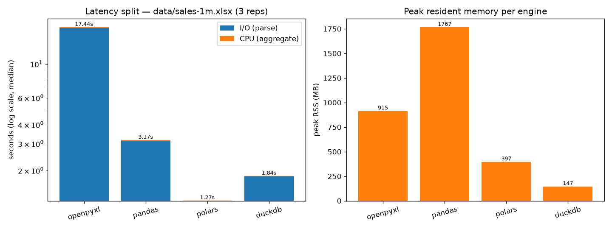

# Reference run — 1,000,000 rows, seed 42

Machine: Linux 7.2.9-2-cachyos, x86_64, 12 logical / 6 physical cores, 12.39 GB RAM.
Python 3.12.15. Dataset: `logical_sha256=acdc4cbab17a7167`, 2,000 anomalies,
generated in 13.1 s (24 MB `.xlsx`, near the 1,048,576-row format limit).

Command: `bench.runner --repeats 3 --warmup 1` (medians). Raw data:
[`results/bench-1m.json`](../results/bench-1m.json). Figure reproducible via
`uv run --with matplotlib python tools/plot.py`.

| engine | io_s | cpu_s | total_s | peak_rss_mb | checksum |
|---|---|---|---|---|---|
| openpyxl | 17.2806 | 0.1601 | 17.4402 | 914.66 | 256572839.01 |
| pandas | 3.1251 | 0.0426 | 3.1695 | 1767.20 | 256572839.01 |
| polars | 1.2647 | 0.0044 | 1.2691 | 397.05 | 256572839.01 |
| duckdb | 1.8309 | 0.0086 | 1.8399 | 146.78 | 256572839.01 |

`checksum_agreement=true`.

## Readings (scale changes the story vs the 50k run)

- **Polars wins the wall clock (13.7× over OpenPyXL)**, and the gap widens
  with rows: shared calamine parsing, Arrow-direct frame construction.
- **DuckDB is the memory winner at scale (147 MB)**: streaming parse +
  temp table beats holding full frames. Slowest I/O of the fast group, but
  cheapest resident set — the trade-off to show.
- **Pandas is the memory loser (1.77 GB RSS)**: numpy materialization of 1M
  rows plus group-by temporaries. The "low-cost migration" has a real price
  at this scale.
- **OpenPyXL hits the wall (17.4 s, 915 MB)**: pure-Python cell objects,
  exactly the baseline behavior this motor exists to demonstrate.
- **tracemalloc is blind again**: Polars 14.45 MB / DuckDB 7.46 MB, identical
  to the 5k run. Native allocators bypass it — RSS decides.
